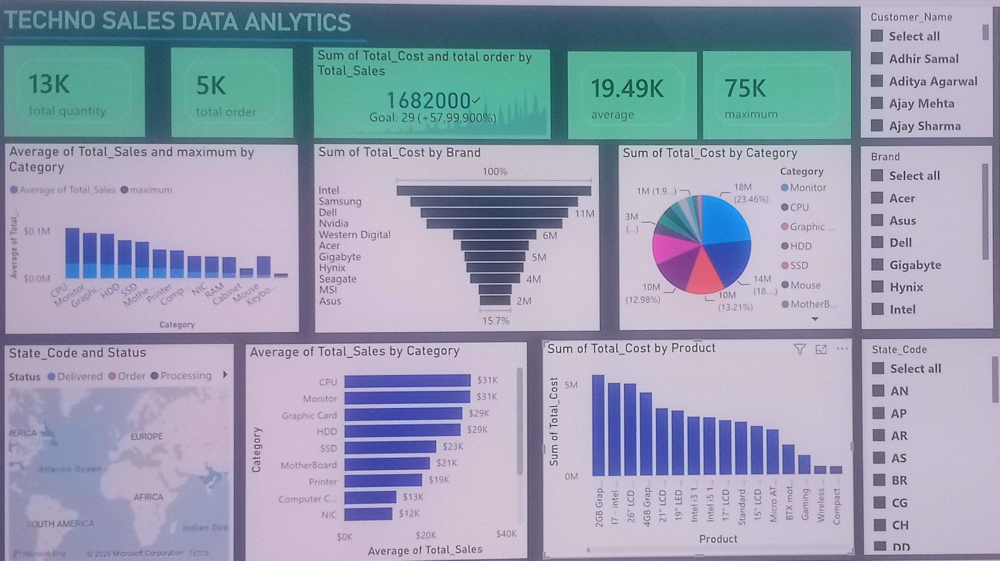
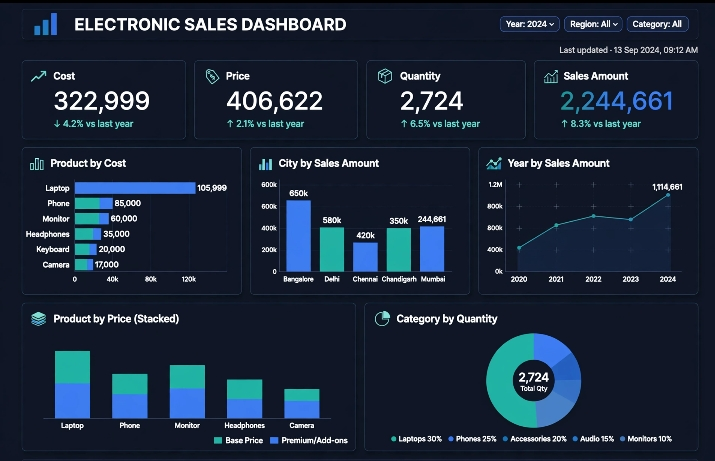

# 👋 Hi, I'm [AMIT JAYSWAL]

### 📊 Data Analyst & Business Intelligence Enthusiast

I turn complex, messy datasets into clear, actionable insights that drive business growth. Passionate about uncovering trends, building automated dashboards, and telling stories with data.

---

## 🛠️ Technical Skills

* **Languages & Querying:** Python (Pandas, NumPy,), SQL (PostgreSQL), R, DAX
* **Data Visualization & BI:** Tableau, Power BI, Looker, Matplotlib, Seaborn
* **Databases & Cloud:** Kaggle, AWS (S3, RDS), Google Cloud Platform
* **Tools & Workflow:** Git/GitHub, Jupyter Notebooks, Excel (VBA, Power Query),

---

## 🚀 Featured Projects

### 1. TECHNO SALES DATA
* **Description:** I am the  created PowerBI dashboard . this is using microsoft power bi to analyze sales data understand Business performance.
                                the dashboard shows tatal quantity, total order ,average sales ,maximum sales , barand-wise sales cost, category-wise sales ,and 
                            product-wise sales.
                        I used for visual for charts ,KPI  cards ,slicers  and map to visualize the data .this is filter users can the dashboard by customer name ,brand and satate a code. 
* **Tech Stack:** Power BI, Excel
* **Key Insights:** Evaluated overall sales performance using KPIs such as Total Quantity, Total Orders, Average Sales, and Maximum Sales.
Identified top-performing brands and high-sales product categories.
Compared product-wise costs and category-wise sales trends.
  | 📊 [Live Dashboard/Demo]()

### 2. [ELECTRONIC SALES DATA]
* **Description:** This project is an electronic sales dashboard created using Tableaun to anlyze  electronic product sales data. it provides insightis inton  total cost ,price ,quantity .and sales amount .The dashboard includes  interactive chart to compare product costs ,city -wisw sales ,yearly sales trends ,product price ,and category wise -quantity.
* **Tech Stack:** Python (Scikit-Learn, XGBoost), PostgreSQL, Tableau
* **Key Insight**

------
*  Laptop is the highest-cost product, followed by Phone and Monitor.
- Bangalore recorded the highest sales amount among the displayed cities.
- Sales showed an overall upward trend from 2020 to 2024.
- Laptop contributes the highest share of total quantity.
- Product pricing analysis helps compare Base Price and Premium/Add-ons.
- Interactive filters allow users to explore sales performance across different years, regions, and categories.
-----
*  | 📊 [Live Dashboard/Demo]()
---
## 📬 Connect with Me

* **LinkedIn:** [LinkedIn Profile](https://linkedin.com/in/
amit-jayswal-0839a4444
)
* **Email:** your.aj4722312@gamil.com
* **Portfolio Website:** [yourportfolio.com](https://yourportfolio.com)
* **Medium / Substack (Data Blogs):** [Link to your blog articles]